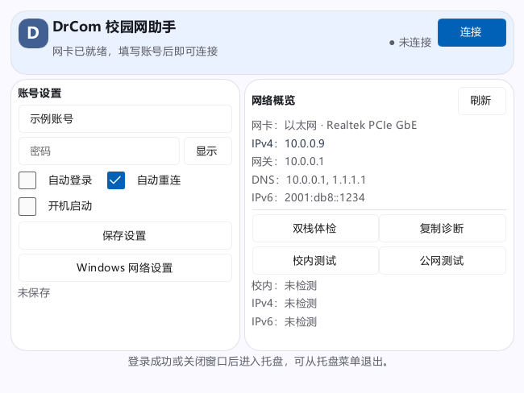

# DrCom 校园网助手（Rust 版）

[](https://github.com/ZincGluxx/drcom-rs/releases/latest)
[](https://www.rust-lang.org/)
[](https://slint.dev/)
[]()
[]()
[]()
[]()
[](LICENSE)

吉林大学（JLU）校园网 Dr.COM 认证客户端的 **Rust + Slint** 重写版。完整实现
challenge → login → keep-alive → logout 协议流程，已对真实认证服务器长期实测通过；
同时提供图形界面与命令行两个入口，并已移植到 Linux x64（见
[Linux 版](#-linux-版)）。



> 同一协议还有一个 C# + Avalonia 实现，见主仓库
> [drcom-net-client](https://github.com/ZincGluxx/drcom-net-client)。

## ⚡ 一行安装（Linux x86_64）

```bash
# 直连 GitHub
curl -fsSL https://raw.githubusercontent.com/ZincGluxx/drcom-rs/linux/install.sh | bash

# 国内网络（脚本与发布包自动走国内镜像，失败自动换源）
curl -fsSL https://ghproxy.net/https://raw.githubusercontent.com/ZincGluxx/drcom-rs/linux/install.sh | bash

# 安装并启用静默开机自启（登录桌面不弹窗、后台自动认证）
curl -fsSL https://ghproxy.net/https://raw.githubusercontent.com/ZincGluxx/drcom-rs/linux/install.sh | bash -s -- --autostart
```

安装到 `~/.local`，无需 root，可重复执行升级；卸载加 `--uninstall`。
完整的安装与账号配置教程见 [docs/install.md](docs/install.md)，
平台细节与差异见 [docs/linux.md](docs/linux.md)。
Windows 用户请使用 Releases 里的 `DrComRust_v<版本>_Setup.exe` 安装包。

## ✨ 特性

**认证与保活**

- 完整 Dr.COM 认证流程，逐字节对应经过实战检验的 B 世代 Python 参考实现。
- 心跳保活自动协商，长时间在线不掉线（实测连续保活 7.5 小时无空档、零失败）。
- 支持多认证服务器地址依次尝试；可选登录前添加认证服务器 /32 主机路由。
- 登录前逐网卡验证认证挑战，绑定源 IP 和出接口，并核对服务器地址、端口、序号及 nonce。
- 登录成功后记住网卡 GUID，重启与重连优先使用；失效后自动探测其他物理网卡。账号密码被拒绝时停止尝试。

**界面与系统集成**

- 单窗口紧凑布局：账号设置 + 网络概览 + 一键检测网络，状态一目了然。
- 跟随桌面浅色 / 暗色主题（Windows 实时切换；Linux 启动时读取 GNOME / KDE 配色）；
  需要固定配色时用环境变量 `DRCOM_THEME=light`（或 `dark`）覆盖。
- 关闭窗口最小化到托盘 / 任务栏，托盘菜单连接 / 下线 / 退出；没有托盘的桌面（如未装扩展的
  GNOME）关闭后最小化到任务栏并在后台静默保活，点击任务栏图标或再次启动即可唤出窗口。
  单实例保护（重复启动会唤醒已运行实例），`--silent` 可静默启动、不弹主窗口。
- 自动登录、自动重连、开机自启；凭据在 Windows 上经 DPAPI 加密保存，Linux 上以
  `0600` 私有权限文件保存（不落公开明文）。

**诊断能力**

- 校内 Ping `jlu.edu.cn`；外网绑定校园网网卡分别进行 IPv4 / IPv6 HTTPS 检测，验证证书和网站响应，使用备用网站复核，并区分 DNS、超时、证书与本机地址问题。
- 主窗口固定为 480 × 380，不允许调整大小；长错误说明通过滚动查看。
- 网络概览展示网卡、IP、网关、DNS 与全局 IPv6 地址。
- 日常运行不写日志文件，不显示协议调试信息；仅保留有上限的内存诊断摘要，退出后清空。
- 登录失败显示原因与处理建议；复制或保存检测结果时包含最近失败、网卡与服务器配置。
- 本地端口默认由系统自动选择，避免端口占用或 Windows 保留范围冲突；服务器端口仍为 61440。

**命令行工具**

- `drcom-cli` 把同一套认证引擎带到无桌面环境（脚本、SSH、服务器），默认只显示连接阶段与错误，`--verbose` 可临时打印协议详情。

## 📊 与 C# 版的资源占用对比

同一台机器、同一协议、同一使用场景下的实测数据（详见
[测试报告](https://github.com/ZincGluxx/drcom-net-client/blob/master/docs/footprint-comparison-2026-09-17.md)）：

| 指标 | Rust + Slint | C# + Avalonia | 倍数 |
| --- | --- | --- | --- |
| 安装包 | **6.53 MB** | 11.57 MB | 1.77× |
| 应用本体 | **13.31 MB** | 32.77 MB | 2.46× |
| 工作集内存 | **23.8 MiB** | 47.9 MiB | 2.0× |
| 私有提交内存 | **5.4 MiB** | 19.8 MiB | 3.7× |
| 线程数 | **4** | 11 | 2.75× |
| 待机 CPU | ≈ 0 | ≈ 0 | 无差异 |

体积差几乎全部来自 Avalonia 捆绑的原生绘图栈（SkiaSharp / libGLESv2 / HarfBuzz
共约 18 MB）；Slint 自带纯 Rust 渲染器，没有这一层。

## 🚀 构建与打包

环境准备：[Rust](https://rustup.rs/)（MSVC 工具链）、Windows SDK（`rc.exe`，
用于编译图标资源；`build.rs` 会自动定位）、[Inno Setup 6](https://jrsoftware.org/isinfo.php)（仅打包需要）。

```bash
# 运行测试
cargo test --offline

# 构建 GUI 与 CLI
cargo build --release --offline

# 静态检查
cargo clippy --offline --all-targets -- -D warnings
cargo fmt --check

# 制作安装包（产出 DrComRust_v<版本>_Setup.exe）
"C:/Program Files (x86)/Inno Setup 6/ISCC.exe" setup.iss
```

版本号在三处同步：`Cargo.toml`、`setup.iss` 的 `AppVersion` 与 `VersionInfoVersion`。

## 🐧 Linux 版

Linux x64 版与 Windows 版共用同一套认证引擎与 Slint 界面，平台差异封装在
`cfg(target_os = "linux")` 的平台层里：网卡枚举通过 `ip -j` 与 `/sys/class/net`，
路由管理改用 `iproute2`，静态 IPv4 通过 NetworkManager（`nmcli`），系统托盘走
StatusNotifierItem（`ksni`），开机启动写入 XDG autostart。详细说明见
[docs/linux.md](docs/linux.md)。

**系统要求**：x86_64 GNU/Linux（glibc）；GUI 需要 X11 或 Wayland 桌面；
`iproute2`、`curl`、`iputils(ping)` 为运行时依赖；可选 `wl-clipboard` 或 `xclip`
（诊断结果复制）、NetworkManager（静态 IPv4 设置）。`--auth-route-apply` 与修改
静态 IPv4 需要 root / polkit 授权。

**构建（Linux）**：

```bash
# 依赖：rustup（Rust 1.85+，edition 2024）
cargo build --release
cargo test
cargo clippy --all-targets -- -D warnings
cargo fmt --check

# 生成发布包：dist/drcom-campus-linux-x86_64-v<版本>.tar.gz + .sha256
bash scripts/package-linux.sh
```

发布包内含 `drcom-campus`（GUI）、`drcom-cli`（CLI）、`drcom.ini.example`、
`install.sh`（用户级安装到 `~/.local`，无需 root）、桌面入口与图标。
`packaging/install.sh` 也可直接从源码仓库安装 `target/release` 下的二进制。

**与 Windows 版的主要差异**：

| 项目 | Windows | Linux |
| --- | --- | --- |
| 托盘 | Shell_NotifyIcon | StatusNotifierItem（GNOME 需 AppIndicator 扩展；无托盘时关闭窗口转为后台静默保活，再次启动唤出窗口） |
| 静默运行 | 最小化到托盘 | `drcom-campus --silent` 不显示窗口直接后台登录保活；开机自启条目自带 `--silent` |
| 凭据 | DPAPI 加密 | 私有目录 `0700` + 文件 `0600`，JSON 明文 |
| 开机启动 | HKCU Run 注册表 | `~/.config/autostart/*.desktop` |
| 配置搜索 | exe 目录 / cwd / `%APPDATA%\DrComCampus` | exe 目录 / cwd / `~/.config/drcom-campus` |
| 主机路由 | IP Helper + `route.exe` | `ip route` |
| 静态 IPv4 | `netsh`（UAC 提权） | `nmcli`（NetworkManager + polkit） |

## 🖥 使用

### 图形界面 `drcom-campus`（Windows 下为 `drcom-campus.exe`）

启动后填写账号密码即可连接。Linux 下可用 `drcom-campus --silent` 静默启动：保存账号并
勾选“自动登录”后，程序不显示窗口，直接在后台认证并保活；再次启动程序可唤出窗口。
可选配置文件 `drcom.ini`（模板见
[drcom.ini.example](drcom.ini.example)），按以下顺序查找第一个存在的：

1. 可执行文件所在目录
2. 当前工作目录
3. `%APPDATA%\DrComCampus\`（Windows）或 `$XDG_CONFIG_HOME/drcom-campus/`
   （Linux，默认 `~/.config/drcom-campus/`）

全部键均可省略：认证服务器有内置默认值，账号密码可留空由界面输入
（推荐留空，避免明文落盘）。

### 命令行 `drcom-cli`（Windows 下为 `drcom-cli.exe`）

```text
drcom-cli --user 20230001 --pass secret
          [--server 10.100.61.3[,10.100.61.4]] [--local-ip 10.100.61.20]
          [--mac aa:bb:cc:dd:ee:ff] [--duration 秒] [--once] [--quiet]
```

- 密码可用环境变量 `DRCOM_PASSWORD` 传入，避免进入命令行历史；任何情况下不回显密码。
- `--once` 认证成功后立即下线；`--duration 0`（默认）持续保活，按 Enter 或输入 `q` 停止。
- `--auth-route` / `--auth-route-apply` 查看或应用认证服务器主机路由（后者需管理员；
  Linux 上即 root/sudo）。

## 🔬 协议实现与测试

- 认证逻辑以社区 B 世代 Python 实现（`newclient.py` / `jlu-drcom-py3`）为基准，
  `src/reference_login.rs` 与之逐字节对应，是本部署实际认证成功的那一套。
- 登录帧长度随密码长度变化（368 / 370 / 373 / 374 字节），实现按 `password.len()`
  动态构造，参考向量固化在 `reference/` 下并由测试钉住。
- `reference/` 同时提供生成 / 校验向量的 Python 脚本，可独立复核协议实现。
- 测试覆盖：协议帧构造、配置解析（含错误行号提示）、偏好序列化、单实例、
  图标资源、配色可读性（对比度断言）、UI 后端、网卡切换与挑战回复校验，
  以及 Linux 平台层（网卡枚举、路由解析、接口绑定、GBK 解码、XDG 路径）等 133 项。

## 📂 目录结构

```
drcom-rs/
├── src/            # 协议（auth/keepalive/transport）、会话、适配器、诊断、UI 后端
│   └── bin/        # drcom-cli 命令行入口
├── ui/             # Slint 界面描述（app.slint）
├── assets/         # 图标资源（exe 内嵌 + 托盘/窗口）
├── reference/      # 协议参考向量与 Python 校验脚本
├── examples/       # UI 预览示例
├── scripts/        # Linux 发布打包脚本
├── packaging/      # Linux 安装脚本与桌面入口
└── docs/           # 截图与 Linux 使用说明（linux.md）
```

## 🔗 相关仓库

- [drcom-net-client](https://github.com/ZincGluxx/drcom-net-client) — 主仓库：
  C# + Avalonia 实现与全部开发文档、诊断报告。
- [jlu-drcom-client](https://github.com/ZincGluxx/jlu-drcom-client) — 四个协议
  世代共八套社区实现的汇总参考。

## 📄 许可

本项目（含本仓库与主仓库的 C# 实现）以
[CC BY-NC 4.0](https://creativecommons.org/licenses/by-nc/4.0/)（署名—非商业性使用）授权，
完整文本见 [LICENSE](LICENSE)。使用、修改、分享时请保留作者署名（ZincGlux），
且不得用于商业目的。

## ⚠️ 声明

本项目为学习与个人使用目的对校园网认证协议的社区实现整理，仅限在
**你自己有合法账号的校园网内**使用；请遵守所在学校与运营商的网络使用规定。
