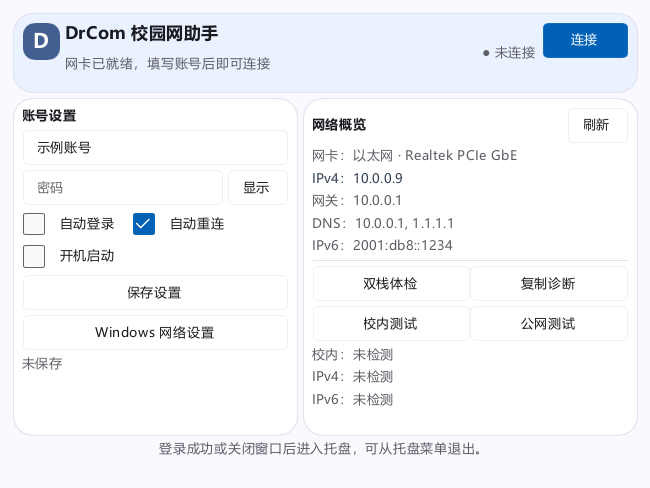

# DrCom 校园网助手（Rust 版）

[](https://github.com/ZincGluxx/drcom-rs/releases/latest)
[](https://www.rust-lang.org/)
[](https://slint.dev/)
[](docs/platforms.md)
[](LICENSE)

吉林大学（JLU）校园网 Dr.COM 认证客户端的 **Rust + Slint** 重写版。完整实现
challenge → login → keep-alive → logout 协议流程，已对真实认证服务器长期实测通过。
仓库已拆分为 Cargo workspace：后端（core / service）与前端分离，自带图形界面与命令行
两个前端，并提供可被其他程序复用的无界面后端进程。



> 同一协议还有一个 C# + Avalonia 实现，见主仓库
> [drcom-net-client](https://github.com/ZincGluxx/drcom-net-client)。

> **分支说明**：`main` / `windows` 保留既有 Windows 发布线，
> [`linux`](https://github.com/ZincGluxx/drcom-rs/tree/linux) 保留已有 Linux 实现；
> 本次 macOS 与三端 workspace 集成在独立 `macos` 分支开发，未改写其他分支。
> Linux 的网卡、路由、静默启动和安装布局复用自 `origin/linux`，不是另起一套客户端。
> 平台差异与安装说明见 [三端支持说明](docs/platforms.md)。

## ✨ 特性

**认证与保活**

- 完整 Dr.COM 认证流程，逐字节对应经过实战检验的 B 世代 Python 参考实现。
- 心跳保活自动协商，长时间在线不掉线（实测连续保活 7.5 小时无空档、零失败）。
- 支持多认证服务器地址依次尝试；可选登录前添加认证服务器 /32 主机路由。
- 登录前逐网卡验证认证挑战，绑定源 IP 和出接口，并核对服务器地址、端口、序号及 nonce。
- 登录成功后记住网卡标识（Windows GUID / Unix 接口名），重启与重连优先使用；失效后探测其他物理网卡。账号密码被拒绝时停止尝试。

**界面与系统集成**

- 单窗口紧凑布局：账号设置 + 网络概览 + 一键检测网络，状态一目了然。
- 跟随平台浅色 / 暗色主题；Linux X11 额外读取 GNOME/KDE 启动时配色，需要固定配色时用 `DRCOM_THEME=light` / `dark`。
- Windows 关闭到托盘；macOS/Linux 最小化保留可恢复的 Dock/任务栏入口，无托盘的 GNOME 也可使用。重复启动唤出已有实例。
- 自动登录、重连、登录自启：Windows 注册表、macOS LaunchAgent、Linux XDG autostart。
- 凭据使用 Windows DPAPI / macOS Keychain / Linux Secret Service；密钥环不可用时明确报错，不明文回退。
- Windows/Linux 可编辑静态 IPv4（分别使用 UAC/netsh、NetworkManager/polkit）；macOS 打开系统网络设置，不伪装支持应用内编辑。

**诊断能力**

- 校内 Ping `jlu.edu.cn`；外网绑定校园网网卡分别进行 IPv4 / IPv6 HTTPS 检测，验证证书和网站响应，使用备用网站复核，并区分 DNS、超时、证书与本机地址问题。
- 主窗口固定为 480 × 380，不允许调整大小；长错误说明通过滚动查看。
- 网络概览展示网卡、IP、网关、DNS 与全局 IPv6 地址。
- 日常运行不写日志文件，不显示协议调试信息；仅保留有上限的内存诊断摘要，退出后清空。
- 登录失败显示原因与处理建议；复制或保存检测结果时包含最近失败、网卡与服务器配置。
- 本地端口默认由系统自动选择，避免端口占用或 Windows 保留范围冲突；服务器端口仍为 61440。

**命令行工具与后端复用**

- `drcom-cli` 把同一套认证引擎带到无桌面环境（脚本、SSH、服务器），默认只显示连接阶段与错误，`--verbose` 可临时打印协议详情。
- `drcom-daemon` 是无界面后端宿主：通过 JSON-lines 协议（stdio 或回环 TCP）把同一套后端提供给其他语言/进程，协议见 [docs/ipc-protocol.md](docs/ipc-protocol.md)。
- Rust 程序也可以进程内直接复用 `drcom-service` 的 `Command` / `Snapshot` / `Notification` 契约，见 [docs/frontend-guide.md](docs/frontend-guide.md)。

## 📊 与 C# 版的资源占用对比

同一台机器、同一协议、同一使用场景下的实测数据（详见
[测试报告](https://github.com/ZincGluxx/drcom-net-client/blob/master/docs/footprint-comparison-2026-09-17.md)）：

| 指标 | Rust + Slint | C# + Avalonia | 倍数 |
| --- | --- | --- | --- |
| 安装包 | **6.53 MB** | 11.57 MB | 1.77× |
| 应用本体 | **13.31 MB** | 32.77 MB | 2.46× |
| 工作集内存 | **23.8 MiB** | 47.9 MiB | 2.0× |
| 私有提交内存 | **5.4 MiB** | 19.8 MiB | 3.7× |
| 线程数 | **4** | 11 | 2.75× |
| 待机 CPU | ≈ 0 | ≈ 0 | 无差异 |

体积差几乎全部来自 Avalonia 捆绑的原生绘图栈（SkiaSharp / libGLESv2 / HarfBuzz
共约 18 MB）；Slint 自带纯 Rust 渲染器，没有这一层。

## 🚀 构建与打包

使用 [Rust](https://rustup.rs/) 1.98（CI 固定 1.98.0），保留 `Cargo.lock`。
Windows 需 MSVC + Windows SDK，macOS 需 Xcode Command Line Tools；Linux 开发包清单与本机打包步骤见 [BUILDING.md](packaging/BUILDING.md)。

```bash
# 构建 GUI / CLI / daemon（macOS/Linux 可执行文件无 .exe 后缀）
cargo build --locked --release --workspace --bins
cargo test --locked --workspace --all-targets
cargo clippy --locked --workspace --all-targets -- -D warnings
cargo fmt --all -- --check

# 示例：在 Apple Silicon Mac 上编译并打包
cargo build --locked --release --workspace --bins --target aarch64-apple-darwin
python3 scripts/package.py package --target aarch64-apple-darwin
```

版本只改根 `Cargo.toml` 的 `[workspace.package] version`；安装包从它或可执行文件资源取版本，不再手工同步 ISS。

### GitHub Actions

[三端流水线](.github/workflows/native.yml) 覆盖四个原生目标：

| 平台 | 构建目标 | 下载包 |
| --- | --- | --- |
| Windows x64 | `x86_64-pc-windows-msvc` | 安装 EXE + portable ZIP |
| macOS Apple Silicon | `aarch64-apple-darwin` | `.app.tar.gz` + DMG |
| macOS Intel | `x86_64-apple-darwin` | `.app.tar.gz` + DMG |
| Linux x64 | `x86_64-unknown-linux-gnu` | tar.gz + DEB |

- push/PR：格式、Clippy、原生单元/集成测试与打包脚本测试；推送 `macos` 集成分支还会构建打包四个目标并上传 Artifacts，**不发布 Release**。
- **Actions → Run workflow**：编译四个目标并上传 Artifacts，**不发布 Release**。
- 推送 **`v<workspace版本>` 标签**：全部测试与打包成功后发布 8 个主资产、单独校验文件和 `SHA256SUMS`。标签与版本不一致会失败；已有 Release 不覆盖。
- macOS 目前为 **ad-hoc 签名，未 Developer ID 签名/公证**；Linux tar.gz 是动态链接 portable 包，**不是 AppImage**。
- 更改代码不等于已执行 GitHub 构建；需将分支推送后在 GitHub 运行。当前版本如已有同名历史标签，应先选择新版本再创建标签，不能覆盖旧发布。

操作细节见 [打包与发布说明](packaging/BUILDING.md)，本地验证范围与尚未执行项见 [验证记录](docs/cross-platform-validation.md)。

## 🖥 使用

### 图形界面 `drcom-campus.exe`

启动后填写账号密码即可连接。可选配置文件 `drcom.ini`（模板见
[drcom.ini.example](drcom.ini.example)），按以下顺序查找第一个存在的：

1. 可执行文件所在目录
2. 当前工作目录
3. 平台用户配置目录：Windows `%LOCALAPPDATA%\DrComCampusRust`（兼容旧 `%APPDATA%\DrComCampus`）；macOS `~/Library/Application Support/DrComCampusRust`；Linux `$XDG_CONFIG_HOME/DrComCampusRust`（默认 `~/.config/DrComCampusRust`，兼容旧 `drcom-campus` 目录）。

macOS 应先把 `.app` 移到 Applications 再保存开机启动设置。Linux 无 StatusNotifierWatcher 时关闭到后台会最小化而非隐藏。
GUI 同时接受 `--tray` / `--silent` / `--background` 静默启动；无托盘时保留最小化的任务栏入口。

全部键均可省略：认证服务器有内置默认值，账号密码可留空由界面输入
（推荐留空，避免明文落盘）。

### 命令行 `drcom-cli.exe`

```text
drcom-cli --user 20230001 --pass secret
          [--server 10.100.61.3[,10.100.61.4]] [--local-ip 10.100.61.20]
          [--mac aa:bb:cc:dd:ee:ff] [--duration 秒] [--once] [--quiet]
```

- 密码可用环境变量 `DRCOM_PASSWORD` 传入，避免进入命令行历史；任何情况下不回显密码。
- `--once` 认证成功后立即下线；`--duration 0`（默认）持续保活，按 Enter 或输入 `q` 停止。
- `--auth-route` / `--auth-route-apply` 查看或应用认证服务器主机路由（后者需管理员）。
- `--config <文件>` 指定 INI，`--verbose` 打印协议详情，完整参数见 `drcom-cli --help`。

### 无界面后端 `drcom-daemon.exe`

供其他进程/语言复用后端，不是日常使用的入口：在 stdio 或回环 TCP 上按 JSON-lines 收发
命令与通知；登录命令会携带凭据，因此只应通过 stdio 或回环地址使用，不要暴露到校园网。
协议、启动参数与示例见 [docs/ipc-protocol.md](docs/ipc-protocol.md)。

## 🔬 协议实现与测试

- 认证逻辑以社区 B 世代 Python 实现（上游 [drcoms/jlu-drcom-client](https://github.com/drcoms/jlu-drcom-client)
  的 `newclient.py` / `jlu-drcom-py3`）为基准，
  `crates/drcom-core/src/reference_login.rs` 与之逐字节对应，是本部署实际认证成功的那一套。
- 登录帧长度随密码长度变化（368 / 370 / 373 / 374 字节），实现按 `password.len()`
  动态构造，参考向量固化在 `crates/drcom-core/reference/` 下并由测试钉住。
- `crates/drcom-core/reference/` 同时提供生成 / 校验向量的 Python 脚本，可独立复核协议实现。
- 测试覆盖：协议帧构造、配置解析（含错误行号提示）、偏好序列化、单实例、
  图标资源、配色可读性（对比度断言）、服务状态机、网卡切换与挑战回复校验等；
  各 crate 的测试随 `cargo test --workspace --offline` 一起运行。

## 📂 项目结构

后端与前端已拆成 Cargo workspace（版本在根 `Cargo.toml` 的 `[workspace.package]` 定义）：

```
drcom-rs/
├── Cargo.toml                 # workspace 根清单；版本只在这里定义
├── setup.iss                  # Inno Setup 安装脚本（版本需单独同步）
├── drcom.ini.example
├── docs/                      # 截图、发布说明，以及架构 / 前端 / IPC 文档
└── crates/
    ├── drcom-core/            # 协议、认证、会话、网卡、配置、凭据、探针（无 UI 依赖）
    │   ├── reference/         # 协议参考向量与 Python 校验脚本
    │   └── examples/          # 网卡探测示例
    ├── drcom-service/         # 前端无关应用层：Command / Snapshot / Notification
    │   └── src/api.rs         # 冻结的前端契约
    ├── drcom-ipc/             # JSON-lines 协议
    ├── drcom-daemon/          # 无界面后端宿主（stdio / 回环 TCP）
    ├── drcom-gui/             # Slint 桌面窗口、托盘、单实例、剪贴板（drcom-campus.exe）
    │   ├── ui/app.slint
    │   ├── assets/
    │   └── examples/
    └── drcom-cli/             # 命令行前端（直连 drcom-core）
```

依赖方向是 `drcom-core ← drcom-service ← 前端`；各 crate 的职责、旧模块映射与扩展方式见
[docs/backend-architecture.md](docs/backend-architecture.md)。

## 🧩 复用后端 / 接入其他前端

- **Rust 进程内**：依赖 `crates/drcom-service`，只使用 `Command` / `Snapshot` /
  `Notification` 契约——订阅、渲染快照、发命令、每秒 `tick`，完整教程与示例见
  [docs/frontend-guide.md](docs/frontend-guide.md)。
- **其他语言 / 独立进程**：运行 `drcom-daemon`，通过 stdio 或回环 TCP 上的 JSON-lines
  收发同样的命令与通知，协议见 [docs/ipc-protocol.md](docs/ipc-protocol.md)。
- **凭据边界**：`Snapshot` 永不包含密码；Rust 前端用 `form_seed` 初始化表单，其他语言
  前端在发登录命令时携带凭据，所以 daemon 只能走 stdio 或回环地址。
- 使用 `drcom-cli` 的脚本需要原始会话事件流，因此它有意直接依赖 `drcom-core`，不经过
  `drcom-service`。

分层的设计目标、线程与顺序规则、凭据边界与契约版本说明都在
[docs/backend-architecture.md](docs/backend-architecture.md)。

## 🔗 相关仓库

- [drcom-net-client](https://github.com/ZincGluxx/drcom-net-client) — 主仓库：
  C# + Avalonia 实现与全部开发文档、诊断报告。
- [drcoms/jlu-drcom-client](https://github.com/drcoms/jlu-drcom-client) — 本仓库认证
  实现的上游参考：四个协议世代共八套社区实现（AGPL-3.0；本地 fork 见
  [ZincGluxx/jlu-drcom-client](https://github.com/ZincGluxx/jlu-drcom-client)）。

## 📄 许可

本仓库与主仓库 [drcom-net-client](https://github.com/ZincGluxx/drcom-net-client) 一并以
[GNU Affero 通用公共许可证第 3 版（AGPL-3.0）](https://www.gnu.org/licenses/agpl-3.0.html)
授权，完整法律文本见 [LICENSE](LICENSE)，版权与许可提示见 [NOTICE](NOTICE)，
上游归属说明见 [THIRD-PARTY-NOTICES.md](THIRD-PARTY-NOTICES.md)。

- 可以自由地使用、修改、分发本项目，包括商业用途；
- 分发修改版时，须以 AGPL-3.0 提供完整源码，并保留原有版权与归属声明；
- 若将本程序（或其修改版）作为网络服务提供给他人使用，也必须向这些用户提供对应源码（AGPL 第 13 条）。

> **许可变更说明**：v1.2.1 及更早版本以 CC BY-NC 4.0 发布；自本次变更起，本仓库代码统一改为 AGPL-3.0。
> 已按 CC BY-NC 4.0 获得的旧版本，仍适用其当时的许可条款。

## ⚠️ 声明

本项目为学习与个人使用目的对校园网认证协议的社区实现整理，仅限在
**你自己有合法账号的校园网内**使用；请遵守所在学校与运营商的网络使用规定。
